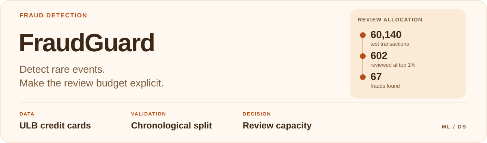
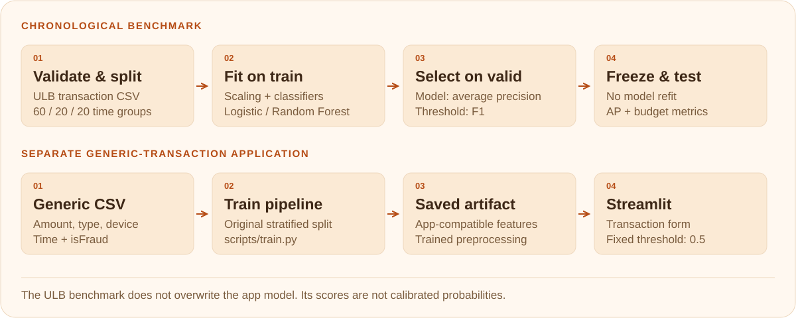

<picture>
  <source media="(max-width: 600px) and (prefers-color-scheme: dark)" srcset="docs/assets/readme/cover-dark-mobile.svg">
  <source media="(max-width: 600px)" srcset="docs/assets/readme/cover-light-mobile.svg">
  <source media="(prefers-color-scheme: dark)" srcset="docs/assets/readme/cover-dark.svg">
  
</picture>

<p align="center">
  <a href="#measured-result">Results</a> &nbsp;·&nbsp;
  <a href="#architecture">Architecture</a> &nbsp;·&nbsp;
  <a href="#reproduce-the-ulb-experiment">Reproduce</a> &nbsp;·&nbsp;
  <a href="#ieee-cis-history-and-graph-experiment">IEEE-CIS</a> &nbsp;·&nbsp;
  <a href="#existing-application">Local app</a> &nbsp;·&nbsp;
  <a href="#evidence-and-limits">Limits</a>
</p>

## Overview

**Imbalanced classification with chronological validation and an explicit review budget.**

FraudGuard compares Logistic Regression and Random Forest for transaction
classification. The portfolio benchmark uses the ULB credit-card schema and
separates model selection, threshold selection and final evaluation.

An additional IEEE-CIS experiment compares transaction attributes, prior event
history and graph features under the same chronological split and review budget.

## Measured result

Completed on the original **284,807 transactions / 492 fraud cases**. Logistic
Regression was selected by validation average precision. On the chronological
held-out test (60,140 transactions / 77 frauds):

| Metric | Selected Logistic Regression |
| --- | ---: |
| Average precision | 0.7510 |
| ROC-AUC | 0.9825 |
| Precision at validation-selected threshold | 0.9455 |
| Recall at validation-selected threshold | 0.6753 |
| Recall within a top-1% review budget | 0.8701 |
| Precision within that review budget | 0.1113 |

The top-1% rule reviewed 602 transactions and found 67 fraud cases. The frozen
validation threshold reviewed approximately 0.0915% of test transactions. These
are different workloads. The class-weighted model's scores are not calibrated
fraud probabilities.

[Full measured report, split ranges and provenance](reports/creditcard.json) ·
[Source manifest](data/creditcard_source.json). Values are rounded only here;
the JSON retains full precision. No confidence interval or superiority claim is
made from this single historical split.

## Architecture

<picture>
  <source media="(max-width: 600px) and (prefers-color-scheme: dark)" srcset="docs/assets/readme/architecture-dark-mobile.svg">
  <source media="(max-width: 600px)" srcset="docs/assets/readme/architecture-light-mobile.svg">
  <source media="(prefers-color-scheme: dark)" srcset="docs/assets/readme/architecture-dark.svg">
  
</picture>

The benchmark and application have separate input contracts and model artifacts.
In the benchmark, validation selects both the model and threshold; the test set
only evaluates that frozen choice.

| Workflow | Entry point | Output |
| --- | --- | --- |
| Chronological ULB experiment | [`scripts/benchmark.py`](scripts/benchmark.py) | Versioned JSON report with provenance and review-budget metrics |
| IEEE-CIS feature comparison | [`scripts/benchmark_ieee.py`](scripts/benchmark_ieee.py) | Three fixed feature variants, simulated label delay and a shared review budget |
| Generic transaction application | [`scripts/train.py`](scripts/train.py) → [`app/app.py`](app/app.py) | App-compatible model and interactive predictions |

## Benchmark protocol

- Split **distinct timestamps** into 60% training / 20% validation / 20% test.
  Transactions with the same timestamp stay together; future rows never fit scaling.
- Train on V1–V28 and Amount. Time is used only to define the split.
- Choose the model by **validation average precision**; choose its threshold by
  validation F1. Freeze both and evaluate the selected model once on test.
- Report average precision (stepwise PR area), ROC-AUC, precision/recall at the
  frozen threshold, actual threshold workload, and precision/recall among the
  highest-scoring **1%** of a batch.
- Preserve full class prevalence: no test downsampling, oversampling or SMOTE.

The top-1% metric uses an exact review capacity and stable label-independent tie
breaking. A frozen threshold may produce a different workload as the distribution
changes; the report shows both quantities.

## Reproduce the ULB experiment

The minimal benchmark environment is separate from the optional Streamlit app.
Use Python 3.12 for the pinned numerical environment:

```bash
git clone https://github.com/ssivitskii/FraudGuard.git
cd FraudGuard
python3.12 -m venv .venv-benchmark
source .venv-benchmark/bin/activate
pip install -r requirements-benchmark.txt
python -m scripts.download_creditcard
python -m scripts.benchmark --data data/raw/creditcard.csv --output reports/creditcard.json
python -m pytest -o addopts='' -q
```

Data source: [official TensorFlow tutorial and mirror](https://www.tensorflow.org/tutorials/structured_data/imbalanced_data),
with attribution to [Worldline / ULB](https://www.kaggle.com/datasets/mlg-ulb/creditcardfraud).
Raw transactions are excluded from Git. The downloader records the source URL,
file size and SHA-256; consult original data terms separately from the code license.

The benchmark expects the original `Time,V1..V28,Amount,Class` schema and rejects
missing, infinite or nonbinary inputs. It does not write a model over the app's
artifact: its numerical features differ from the interactive form.

## IEEE-CIS history and graph experiment

**Question:** do event history and connections between coarse card/device
signatures improve future fraud detection at the same review capacity?

| Variant | Inputs |
| --- | --- |
| `tabular` | Transaction amount, product, card/address categories, email domains and device descriptors |
| `history` | Tabular inputs + prior event count, mean amount and time since the last event for each signature |
| `graph` | History inputs + number of distinct prior neighbours on each side of the card–device graph and prior pair count |

All three use the same `HistGradientBoostingClassifier` parameters. Categories
are encoded using training data only; unseen values become missing and frequent
categories are retained up to 255 bins. The restricted baseline excludes the
dataset's precomputed V/C/D features, whose derivation is outside this experiment.
This is a controlled feature comparison, not a competition leaderboard baseline.

The card signature is the complete tuple `card1`–`card6`; the device signature is
the complete tuple `DeviceType, DeviceInfo`. These describe broad attributes,
**not verified cardholders or physical devices**. Shared descriptors can connect
unrelated events. Incomplete signatures create no node or edge.

- Sort by `TransactionDT, TransactionID`; split distinct times 60/20/20 using the
  existing chronological splitter. `TransactionDT` is relative time in seconds.
- Compute each history/graph feature from events with **strictly earlier** time.
  Events with equal timestamps cannot see each other. Labels never enter features.
- Assume a fixed **7-day label delay**: only training labels available at validation
  start and validation labels available at test start are eligible. This is a
  simulation; actual label-confirmation timestamps are not supplied.
- Unlabelled event history continues through the excluded intervals and through
  validation/test. Models and category encoders stay frozen after training.
- Select a variant by validation average precision and each variant's threshold
  by validation F1. Report all three predeclared ablations on the same final test.
- Use an exact top-1% batch capacity for every variant. This retrospective ranking
  metric is distinct from an online decision policy or a calibrated risk estimate.

Download `train_transaction.csv` and `train_identity.csv` from the
[IEEE-CIS competition](https://www.kaggle.com/competitions/ieee-fraud-detection/data)
after accepting its data rules, and put both in `data/raw/ieee-cis/`. All labelled
transactions are retained by a left join; identity attributes are missing for
transactions with no matching identity row. Raw data stays outside Git.

With the benchmark environment above activated:

```bash
python -m scripts.benchmark_ieee \
  --data-dir data/raw/ieee-cis \
  --label-delay-days 7 \
  --review-budget 0.01 \
  --output reports/ieee.json
```

The report records input/source hashes, feature lists, model parameters, split
sizes, label eligibility and validation/test metrics. `--label-delay-days 0`
removes the simulated delay. No measured IEEE-CIS result is claimed until the
complete dataset has been run. The local Streamlit form uses its separate generic
transaction schema and does not serve this experiment's models.

## Existing application

A separate generic-transaction workflow remains available. From the repository
root, use a Python 3.12 virtual environment and a CSV matching the schema below:

```bash
python -m pip install -e '.[dev]'
python -m scripts.train --data transactions.csv --model both
python -m streamlit run app/app.py
```

Its CSV contains `amount`, `transaction_type`, `device_type`, `transaction_time`
and binary `isFraud`. It uses the original stratified split and fixed app threshold
of 0.5. Its numbers should not be confused with the chronological ULB benchmark.
Additional training features must also be supplied at inference. Missing-value
imputation is not implemented for that application.

## Evidence and limits

The benchmark emits a versioned JSON report with split times, class counts,
validation comparisons, final metrics, EDA summary, data/source hashes and library
versions. Reported results belong only to the exact file and protocol recorded
there. Dataset-specific results are linked below when a complete run is available.

Two days of historical transactions are a small time window. Card/entity IDs are
unavailable for group holdout. The anonymous PCA features were created upstream;
their fitting provenance cannot be audited here. Neither AP nor a review-budget
metric is a deployment or financial impact estimate. Rank-based cohort scoring
and calibrated fraud probabilities are different concepts.

## Repository

- `scripts/benchmark.py`: chronological experiment and review-budget metrics.
- `fraudguard/`: preprocessing, models, scoring and data-split helpers.
- `notebooks/`: executable EDA and benchmark walkthroughs, without embedded data.
- `app/`: optional Streamlit demo.
- `tests/`: threshold, schema, split and model regression checks.

[MIT code license](LICENSE). Dataset rights remain with their respective publishers.

---

[← Back to portfolio](https://github.com/ssivitskii#selected-work)
