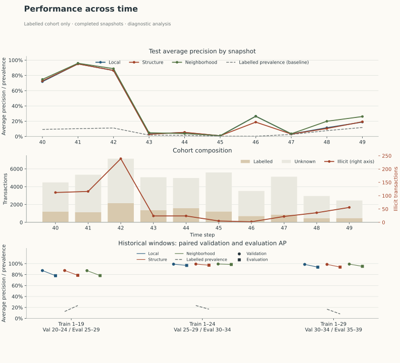
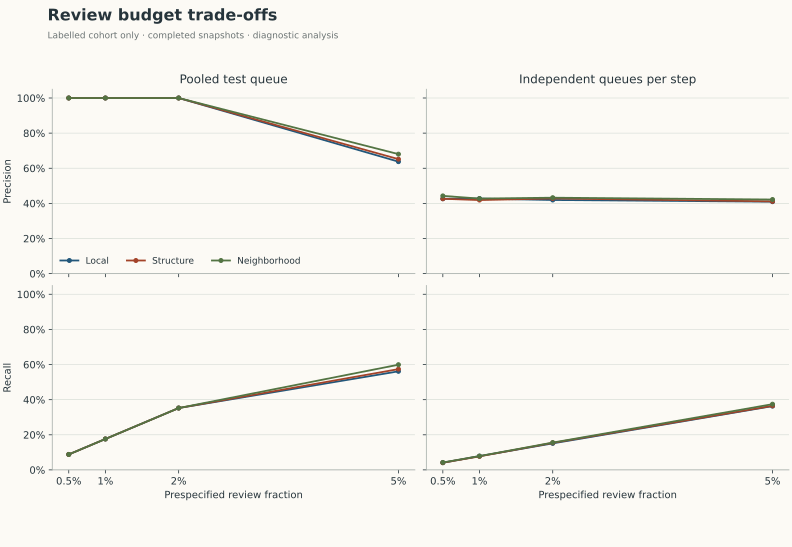
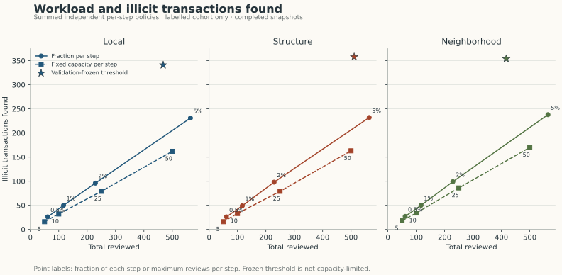

<picture>
  <source media="(max-width: 600px) and (prefers-color-scheme: dark)" srcset="docs/assets/readme/cover-dark-mobile.svg">
  <source media="(max-width: 600px)" srcset="docs/assets/readme/cover-light-mobile.svg">
  <source media="(prefers-color-scheme: dark)" srcset="docs/assets/readme/cover-dark.svg">
  
</picture>

<p align="center">
  <a href="#measured-result">Results</a> &nbsp;·&nbsp;
  <a href="#architecture">Architecture</a> &nbsp;·&nbsp;
  <a href="#reproduce-the-ulb-experiment">Reproduce</a> &nbsp;·&nbsp;
  <a href="#elliptic-graph-experiment">Elliptic</a> &nbsp;·&nbsp;
  <a href="#temporal-stability-and-review-policies">Diagnostics</a> &nbsp;·&nbsp;
  <a href="#transaction-replay-with-delayed-labels">Transaction replay</a> &nbsp;·&nbsp;
  <a href="#existing-application">Local app</a> &nbsp;·&nbsp;
  <a href="#evidence-and-limits">Limits</a>
</p>

## Overview

**Imbalanced classification with chronological validation and an explicit review budget.**

FraudGuard compares Logistic Regression and Random Forest for transaction
classification. The portfolio benchmark uses the ULB credit-card schema and
separates model selection, threshold selection and final evaluation.

An additional Elliptic AML experiment compares local transaction attributes,
graph structure and neighbouring features on future completed graph snapshots.
The synthetic transaction replay adds event-time history, delayed feedback and
weekly retraining, with a separate daily review queue.

## Measured result

Completed on the original **284,807 transactions / 492 fraud cases**. Logistic
Regression was selected by validation average precision. On the chronological
held-out test (60,140 transactions / 77 frauds):

| Metric | Selected Logistic Regression |
| --- | ---: |
| Average precision | 0.7510 |
| ROC-AUC | 0.9825 |
| Precision at validation-selected threshold | 0.9455 |
| Recall at validation-selected threshold | 0.6753 |
| Recall within a top-1% review budget | 0.8701 |
| Precision within that review budget | 0.1113 |

The top-1% rule reviewed 602 transactions and found 67 fraud cases. The frozen
validation threshold reviewed approximately 0.0915% of test transactions. These
are different workloads. The class-weighted model's scores are not calibrated
fraud probabilities.

[Full measured report, split ranges and provenance](reports/creditcard.json) ·
[Source manifest](data/creditcard_source.json). Values are rounded only here;
the JSON retains full precision. No confidence interval or superiority claim is
made from this single historical split.

## Architecture

<picture>
  <source media="(max-width: 600px) and (prefers-color-scheme: dark)" srcset="docs/assets/readme/architecture-dark-mobile.svg">
  <source media="(max-width: 600px)" srcset="docs/assets/readme/architecture-light-mobile.svg">
  <source media="(prefers-color-scheme: dark)" srcset="docs/assets/readme/architecture-dark.svg">
  
</picture>

The benchmark and application have separate input contracts and model artifacts.
In the benchmark, validation selects both the model and threshold; the test set
only evaluates that frozen choice.

| Workflow | Entry point | Output |
| --- | --- | --- |
| Chronological ULB experiment | [`scripts/benchmark.py`](scripts/benchmark.py) | Versioned JSON report with provenance and review-budget metrics |
| Elliptic graph comparison | [`scripts/benchmark_elliptic.py`](scripts/benchmark_elliptic.py) | Three fixed feature variants on future snapshots, with a shared review budget |
| Synthetic transaction replay | [`scripts/replay_handbook.py`](scripts/replay_handbook.py) | Point-in-time history, simulated label delays and daily review metrics |
| Generic transaction application | [`scripts/train.py`](scripts/train.py) → [`app/app.py`](app/app.py) | App-compatible model and interactive predictions |

## Benchmark protocol

- Split **distinct timestamps** into 60% training / 20% validation / 20% test.
  Transactions with the same timestamp stay together; future rows never fit scaling.
- Train on V1–V28 and Amount. Time is used only to define the split.
- Choose the model by **validation average precision**; choose its threshold by
  validation F1. Freeze both and evaluate the selected model once on test.
- Report average precision (stepwise PR area), ROC-AUC, precision/recall at the
  frozen threshold, actual threshold workload, and precision/recall among the
  highest-scoring **1%** of a batch.
- Preserve full class prevalence: no test downsampling, oversampling or SMOTE.

The top-1% metric uses an exact review capacity and stable label-independent tie
breaking. A frozen threshold may produce a different workload as the distribution
changes; the report shows both quantities.

## Reproduce the ULB experiment

The minimal benchmark environment is separate from the optional Streamlit app.
Use Python 3.12 for the pinned numerical environment:

```bash
git clone https://github.com/ssivitskii/FraudGuard.git
cd FraudGuard
python3.12 -m venv .venv-benchmark
source .venv-benchmark/bin/activate
pip install -r requirements-benchmark.txt
python -m scripts.download_creditcard
python -m scripts.benchmark --data data/raw/creditcard.csv --output reports/creditcard.json
python -m pytest -o addopts='' -q
```

Data source: [official TensorFlow tutorial and mirror](https://www.tensorflow.org/tutorials/structured_data/imbalanced_data),
with attribution to [Worldline / ULB](https://www.kaggle.com/datasets/mlg-ulb/creditcardfraud).
Raw transactions are excluded from Git. The downloader records the source URL,
file size and SHA-256; consult original data terms separately from the code license.

The benchmark expects the original `Time,V1..V28,Amount,Class` schema and rejects
missing, infinite or nonbinary inputs. It does not write a model over the app's
artifact: its numerical features differ from the interactive form.

## Elliptic graph experiment

**Question:** do graph structure and neighbouring transaction attributes improve
illicit-transaction classification on future completed Bitcoin graph snapshots?

| Variant | Inputs | Features |
| --- | --- | ---: |
| `local` | Supplied local transaction attributes, excluding time | 93 |
| `structure` | Local attributes + directed in-degree and out-degree | 95 |
| `neighborhood` | Structure inputs + incoming/outgoing neighbours' mean local attributes | 281 |

All three use the same `HistGradientBoostingClassifier` parameters. Neighbour
means are rebuilt from the edge list without labels; a missing neighbourhood has
zero means and zero degree. The 72 supplied aggregate features are excluded.

### Evaluation protocol

- Join labels by transaction ID. `1` means illicit, `2` licit, and `unknown` is
  unlabelled. Unknown nodes contribute only unlabelled graph context and never
  enter model fitting or quality metrics.
- Split all 49 distinct time steps before filtering unknown labels: **1–29
  training / 30–39 validation / 40–49 test**. Models never fit future snapshots.
- Each graph is a **completed snapshot**, including its unlabelled nodes. There
  are no edges between time steps. Adding future snapshots cannot change earlier
  graph features; this does not establish transaction-arrival-time availability.
- Select the variant by validation average precision and each threshold by
  validation F1. Freeze all models and thresholds; evaluate the three predeclared
  variants on the same held-out transactions. No refit or test-driven selection.
- Apply an exact top-1% review budget to the **labelled test cohort**. Report both
  pooled metrics and separate time-step results. Per-step capacities are separate
  queues and need not sum to the pooled capacity.

### Reproduce

The dataset was published by Elliptic and the MIT–IBM Watson AI Lab for research:
[paper](https://arxiv.org/abs/1908.02591). The downloader uses the author's [public dataset export](https://www.kaggle.com/datasets/ellipticco/elliptic-data-set),
which requires no account credentials or phone/identity verification. It verifies the
three CSV hashes; raw data is excluded from Git.

With the benchmark environment above activated:

```bash
python -m scripts.download_elliptic
OMP_NUM_THREADS=4 python -m scripts.benchmark_elliptic \
  --data-dir data/raw/elliptic \
  --review-budget 0.01 \
  --historical-windows \
  --output reports/elliptic.json
python -m scripts.plot_elliptic --report reports/elliptic.json
```

The report records input/source hashes, feature lists, model parameters, class
counts, time boundaries, validation scores, test results by time step and review
policies. The plotting command reads this report without training models; it writes
three SVG figures to `docs/assets/elliptic/`. Omitting `--historical-windows` runs
only the original main split and its review-policy diagnostics.

### Measured comparison

Completed on **203,769 nodes / 234,355 edges / 49 snapshots**. Of the nodes,
157,205 have unknown labels. The final test has **11,184 labelled transactions,
including 636 illicit**, plus 35,463 unknown nodes used only as graph context.

| Variant | Validation AP | Test AP | Test precision @ 1% | Test recall @ 1% |
| --- | ---: | ---: | ---: | ---: |
| Local | 0.9652 | 0.6337 | 1.0000 | 0.1761 |
| + Structure | 0.9657 | 0.6362 | 1.0000 | 0.1761 |
| + Neighbour means | **0.9747** | **0.6634** | 1.0000 | 0.1761 |

Validation selected `neighborhood` before test comparison. Its pooled test AP is
0.0297 above `local` on this split, but **all three find 112 illicit transactions
in 112 reviews**: there is no gain at the chosen 1% budget. The much lower test AP
than validation AP also limits claims about performance on later snapshots.
These results do not establish statistical superiority or operational precision.

[Full measured report, time-step results and provenance](reports/elliptic.json).
Only display values are rounded here; the report preserves full precision.

### Temporal stability and review policies

This follow-up diagnoses the **already inspected test period**; it does not use
that period to tune models, select a budget or establish an independent new win.
The original three feature variants, model parameters, main split and all original
validation/test metrics are unchanged.

Three prespecified historical windows add context before the final test. Each
window trains new models on its own training period, selects a variant and each
threshold on validation, then evaluates without refitting. Labels are assumed
available for fitting and validation; actual label-arrival times are not observed.
The overlapping windows are diagnostic comparisons, not independent replicates.

| Train | Validation | Evaluation | Validation-selected variant | Evaluation AP: local / structure / neighborhood |
| --- | --- | --- | --- | --- |
| 1–19 | 20–24 | 25–29 | Structure | 0.7799 / 0.7860 / 0.7815 |
| 1–24 | 25–29 | 30–34 | Neighborhood | 0.9669 / 0.9709 / 0.9844 |
| 1–29 | 30–34 | 35–39 | Neighborhood | 0.9357 / 0.9368 / 0.9499 |

On the final test, neighborhood AP falls from **0.8883 at step 42 to 0.0484 at
step 43**. This is an observed change in performance, not evidence for a particular
cause. Class prevalence also changes, and steps 45 and 46 have only 5 and 2 known
illicit transactions respectively. The figure shows cohort counts alongside AP;
unknown labels are never treated as legitimate transactions. AP/ROC are undefined
for single-class steps, and recall is undefined when no illicit labels are present.



**Prespecified review policies:** fractions 0.5%, 1%, 2%, 5%; fixed capacities
5, 10, 25, 50 per snapshot; and each model's original validation-F1 threshold.
Fractional budgets round up within each queue; fixed capacities are capped at the
labelled queue size. Ties use time step then transaction ID for the pooled queue,
and transaction ID within a snapshot. No policy uses labels to break ties.

A pooled queue ranks all ten test snapshots together. Independent queues apply
the budget separately to each completed snapshot, with no transfer of capacity
between steps. These are different workloads and both are offline: a snapshot
is not a day, and no within-snapshot arrival order is available. Aggregated
precision and recall divide summed counts, rather than averaging step-level rates.

| Policy, selected neighborhood model | Reviewed | Known illicit found / 636 | Precision | Recall |
| --- | ---: | ---: | ---: | ---: |
| Pooled 1% | 112 | 112 | 1.0000 | 0.1761 |
| 1% per snapshot | 117 | 50 | 0.4274 | 0.0786 |
| 5% per snapshot | 564 | 238 | 0.4220 | 0.3742 |
| 25 reviews per snapshot | 250 | 86 | 0.3440 | 0.1352 |
| Frozen validation threshold | 417 | 354 | 0.8489 | 0.5566 |

The threshold can allocate many reviews to some steps and few to others; it has
**no per-step capacity guarantee**. Its total cannot be interpreted as a win at
an equal review budget. At 5% per snapshot, local / structure / neighborhood find
**231 / 232 / 238** illicit transactions in the same 564 reviews. This descriptive
difference on one previously inspected period does not establish superiority.





All policies rank only the **11,184 labelled test transactions**. The other
**35,463 transactions have unknown labels** and remain graph context. These
results do not estimate precision or workload for an operational queue containing
all transactions. [Exact counts, policies and historical windows](reports/elliptic.json).

### Interpretation limits

This is an offline AML experiment on completed snapshots. The data has no exact
within-snapshot ordering or label-confirmation timestamps; the supplied local
features are anonymous and their real-time availability cannot be audited.
Because unknown labels are excluded, review metrics do not estimate performance
on the entire operational transaction stream. One historical split does not
establish general superiority, calibrated probabilities or financial impact.
The existing Streamlit form uses its separate generic-transaction schema.

## Transaction replay with delayed labels

**Question:** how much does entity history help when fraud labels arrive late?
This experiment uses synthetic transactions from the
[Fraud Detection Handbook](https://fraud-detection-handbook.github.io/fraud-detection-handbook/Chapter_3_GettingStarted/SimulatedDataset.html),
which supplies customer/terminal IDs and timestamps at second-level granularity.
Label-confirmation times are not observed: a uniform delay is simulated for
**both fraud and legitimate transactions**.

### Replay protocol

- Load **1 April–15 July 2018**: 1,016,507 transactions / 8,138 frauds. This is
  a 106-day subset of the official dataset, not its full six-month history.
- Evaluate the same **18 June–15 July** transactions in all four comparisons.
  Refit every seven days on the latest 28 days of events whose labels have
  matured: `[fit_time − delay − 28 days, fit_time − delay)`.
- A label is usable only when `event_time + delay < scoring_or_fit_time`.
  Compare **0 days** (optimistic immediate feedback after the timestamp group)
  with **7 days**. All events at the scoring timestamp are excluded from history.
- Build each training row's features as known at its **original event time**;
  never enrich old rows retroactively with labels available at the later fit.
  Require daily source coverage for the training window, 30-day history and
  both delay intervals before evaluation. Missing required dates are rejected.
- Use the same fixed `HistGradientBoostingClassifier` parameters for every run:
  100 iterations, 31 leaves, learning rate 0.1, L2 1, no early stopping, seed 42.
  No tuning or model selection uses this evaluation period.

| Variant | Features available when the transaction arrives |
| --- | --- |
| Basic (3) | Amount, hour, day of week |
| History (18) | Basic + customer count/mean amount, terminal count, revealed-label count/fraud rate, each over 1/7/30 days |

Activity windows cover `[t − window, t)`. Feedback windows use **label reveal
time**, so their source events lie in `[t − delay − window, t − delay)`.
IDs are grouping keys; neither raw IDs nor `TX_FRAUD_SCENARIO` enters the model.
An empty window has zero count/mean/rate, with the count distinguishing absent
feedback from observed zero fraud.

The implementation computes past-only features in batches and scores each week
with its frozen model. This is a historical replay, not a deployed stream.
**At the end of each day**, rank that day's scores and review the top 1%, rounding
capacity up. Ties use event time then transaction ID. This queue requires a
completed day and does not simulate instant payment blocking. Reviews do not
accelerate labels or alter later transactions; outcomes are evaluated after
labels mature.

### Measured comparison

The common evaluation cohort has **268,441 transactions / 2,439 frauds** across
28 days. Each variant reviews **2,698 transactions** in total.

| Label delay | Features | Mean daily AP | Precision @ daily 1% | Recall @ daily 1% | Frauds found |
| --- | --- | ---: | ---: | ---: | ---: |
| 0 days | Basic | 0.1443 | 0.2191 | 0.2423 | 591 |
| 0 days | History | 0.9027 | 0.7817 | 0.8647 | 2,109 |
| 7 days | Basic | 0.1390 | 0.2179 | 0.2411 | 588 |
| 7 days | History | 0.7261 | 0.6420 | 0.7101 | 1,732 |

At seven-day delay, history finds **1,144 more frauds at the same review count**
than basic features. With history, delaying labels reduces observed recall from
86.47% to 71.01%. Delay changes both training recency and feedback features;
this comparison does not isolate their individual effects. These results belong
to one synthetic realization and period, not to real-world fraud or financial
impact. They do not establish statistical superiority.

AP is an unweighted mean of 28 daily AP values, not pooled AP. Review precision
and recall divide summed counts. Single-class daily AP/ROC and recall without
frauds are undefined. [Full daily results, refit windows and provenance](reports/handbook-replay.json).

### Reproduce the replay

With the pinned Python 3.12 benchmark environment above activated:

```bash
python -m scripts.download_handbook
OMP_NUM_THREADS=4 python -m scripts.replay_handbook \
  --data data/raw/handbook/transactions.csv \
  --output reports/handbook-replay.json
```

The downloader uses the [official raw-data repository at a pinned commit](https://github.com/Fraud-Detection-Handbook/simulated-data-raw/tree/6e67dbd0a3bfe0d7ec33abc4bce5f37cd4ff0d6a).
It verifies the entire archive's SHA-256 **before reading its pickle files**,
then verifies the converted subset CSV. Raw data stays outside Git. The measured
report records input/source hashes, software versions, features and exact fit
boundaries. Dataset terms remain separate from this repository's code license.

## Existing application

A separate generic-transaction workflow remains available. From the repository
root, use a Python 3.12 virtual environment and a CSV matching the schema below:

```bash
python -m pip install -e '.[dev]'
python -m scripts.train --data transactions.csv --model both
python -m streamlit run app/app.py
```

Its CSV contains `amount`, `transaction_type`, `device_type`, `transaction_time`
and binary `isFraud`. It uses the original stratified split and fixed app threshold
of 0.5. Its numbers should not be confused with the chronological ULB benchmark.
Additional training features must also be supplied at inference. Missing-value
imputation is not implemented for that application.

## Evidence and limits

The benchmark emits a versioned JSON report with split times, class counts,
validation comparisons, final metrics, EDA summary, data/source hashes and library
versions. Reported results belong only to the exact file and protocol recorded
there. Dataset-specific results are linked below when a complete run is available.

Two days of historical transactions are a small time window. Card/entity IDs are
unavailable for group holdout. The anonymous PCA features were created upstream;
their fitting provenance cannot be audited here. Neither AP nor a review-budget
metric is a deployment or financial impact estimate. Rank-based cohort scoring
and calibrated fraud probabilities are different concepts.

## Repository

- `scripts/benchmark.py`: chronological experiment and review-budget metrics.
- `fraudguard/`: preprocessing, models, scoring and data-split helpers.
- `notebooks/`: executable EDA and benchmark walkthroughs, without embedded data.
- `app/`: optional Streamlit demo.
- `tests/`: threshold, schema, split and model regression checks.

[MIT code license](LICENSE). Dataset rights remain with their respective publishers.

---

[← Back to portfolio](https://github.com/ssivitskii#selected-work)
